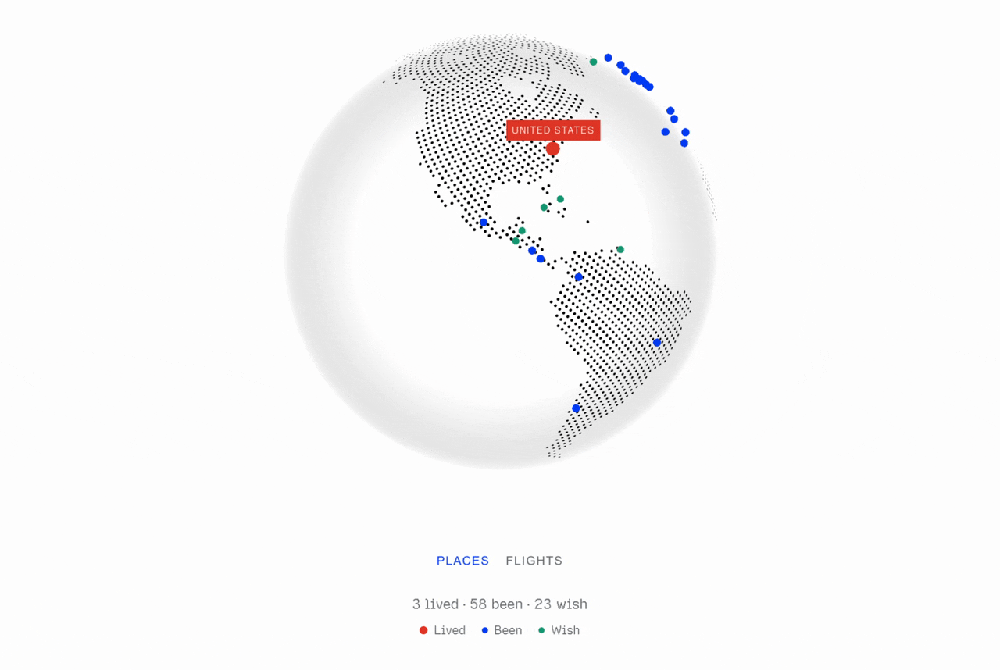

# All the places I've been

A small globe of places you have lived, been, and still want to see, plus the flights between them.

<div align="center">
  
</div>

`data/profiles/` holds sample people, Ada and Leo. Your own globe stays in `private/profiles/`. That folder and `assets/` are not part of this repository. They can live in a separate private repository and be linked back in. Without those links, the globe shows Ada and Leo.

## Run it

```bash
npm install
npm run dev
```

Open the URL Vite prints. With nothing in `private/`, you get Ada and Leo. Under the globe, Places and Flights switch the view, and the name menu switches who the globe belongs to. The big name on the right is that person. Click another name there to add the trips you took with them. A purple dot means more than one selected person has been there. A wish does not count. A polaroid means you were there together. Added people's routes are drawn in orange.

A link opens one person directly: `?person=ada`. Add someone with `&with=leo`, or several people with `&with=leo,mia`.

Click a dot and the globe turns to it. The card says whether that place was lived, been, or wished, and how many flights landed closer to it than to any other dot.

The newest flight pulses on its arrival airport.

## Add yourself

Create `private/profiles/<name>/`. The folder name is the link (`?person=ada`) and the name in the menu.

`places.csv`, one row per place. `status` is `lived`, `been`, or `wish`.

```csv
name,status,latitude,longitude,label
Berlin,lived,52.52,13.405,
Paris,been,48.8566,2.3522,
Reykjavík,wish,64.1466,-21.9426,Iceland
```

`label` is optional. Use it when the name on the globe should be shorter than the place name. If the same place appears twice, `lived` wins over `been`, and `been` wins over `wish`.

Each dot is a point at those coordinates, not a filled-in country.

Add another person by adding another folder. While any private profile exists, the sample people are hidden, so a second person is a second folder next to yours.

## Add flights

Export a CSV from [Flighty](https://flighty.com/) and save it as `flights.csv` in that person's folder. Any other CSV works if it has `From` and `To` airport codes. `Date` is used to find the latest trip. `Canceled` is optional. A canceled row is skipped. Everything else in the file, including seat, PNR, and notes, is ignored.

```csv
Date,From,To,Canceled
2024-06-01,JFK,LHR,false
2024-06-08,LHR,CDG,false
```

Repeated trips between the same airports become one line. The caption still counts every flight.

Airport coordinates come from [OurAirports](https://ourairports.com/) (David Megginson, public domain). Add `airports.csv` in the same folder only when a code is missing or the city name is wrong. A row there replaces the built-in one:

```csv
code,city,latitude,longitude
BKF,Aurora,39.7018,-104.752
```

If two airports in your export share a city name, the label adds the code.

## Mark a trip you took together

Purple means each person has that place on their own list. A polaroid means you were there together.

Add one row to `private/shared.csv`. The place name matches the name in a places file. The people are folder names.

```csv
place,people
Germany,abrish hammad
```

With three or four people, name only the ones who went: `Japan,abrish hammad`. That polaroid shows when the main person and at least one of those names are selected.

A picture of a trip you took together can be several shots. Name them `japan1.jpg`, `japan2.jpg`, and so on, and put them in `assets/`. That folder is gitignored. The shots fan out above the dot when that trip is selected, and they fade when that side of the globe turns away.

`private/` is listed in `.gitignore`. A local `npm run build` still copies whatever is in `private/` into `dist/`, so do not publish that build.
